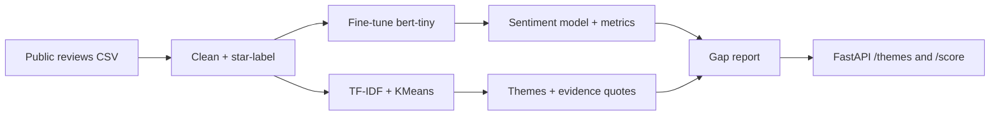

# ComplaintGraph

**Public-review complaint mining → a small trained transformer → evidence-backed product gap reports.**

**Live page:** https://itsoumya-d.github.io/complaintgraph/

ComplaintGraph is an independent, reproducible pipeline for turning public app-store reviews into a
prioritised list of product complaints. It fine-tunes a tiny transformer on a balanced public sample,
clusters negative reviews into themes, and generates a Markdown report with evidence quotes and
suggested experiments.

It does **not** copy proprietary source code, scrape private data, or claim to be an official company
analysis. The input is public reviews; the output is a hypothesis list a product team can validate.

## Why

Most "AI product research" stops at a dashboard. The useful part is the loop:

1. **Listen** — collect public complaints.
2. **Classify** — separate negative/neutral/positive with a trained model.
3. **Cluster** — find the themes behind the complaints.
4. **Decide** — attach an experiment and a metric to each theme.

## Architecture



## Quickstart

```bash
python -m pip install -e ".[dev]"

# 1. Train a small sentiment model on the public app_reviews dataset
python -m complaintgraph.train --limit-per-class 2000 --epochs 1

# 2. Fetch public reviews for a package (requires google-play-scraper)
python scripts/fetch_reviews.py --package com.sumup.app --count 500 --out data/sumup.csv

# 3. Generate the gap report
python -m complaintgraph.analyze --csv data/sumup.csv --app "SumUp" --out reports/sumup_gap_report.md

# 4. Run the API
uvicorn complaintgraph.api:app --reload
```

## API

- `GET /health` — status and whether a model checkpoint is present.
- `POST /themes` — `{"reviews": ["..."]}` → clusters, top terms, evidence quotes.
- `POST /score` — `{"reviews": ["..."]}` → sentiment label, confidence, probabilities.

## Results

Two baselines are included, honestly labelled:

| Method | Accuracy | Macro F1 | Notes |
|---|---:|---:|---|
| Frozen DistilBERT + logistic regression | **0.690** | **0.689** | committed headline artifact |
| End-to-end bert-tiny fine-tune (1 epoch) | 0.532 | 0.527 | CPU-light baseline, under-trained |

These are directional results on a noisy star-derived 3-class task, not SOTA. The point is a reproducible
pipeline with inspectable failure modes.

### Sample report

[`reports/intercom_gap_report.md`](reports/intercom_gap_report.md) analyses 284 public Intercom Conversations
reviews and surfaces five complaint themes (mobile conversation workflow, sign-in/account access, notifications,
update stability). It is an independent analysis of public reviews, not an official company document.

## Model

- Base: [`prajjwal1/bert-tiny`](https://huggingface.co/prajjwal1/bert-tiny) (a deliberately small baseline).
- Data: public `app_reviews` dataset (Google Play reviews with star ratings).
- Labels: 1–2 stars → negative, 3 → neutral, 4–5 → positive.
- Metrics are written to `models/bert-tiny-app-review-sentiment/metrics.json` after training and are
  reported honestly in [MODEL_CARD.md](MODEL_CARD.md).

## What this is not

- Not a production classifier. It is a fast, inspectable baseline.
- Not a causal model. Clusters suggest hypotheses; they do not prove impact.
- Not a replacement for support tickets, product analytics or user interviews.
- Not an official analysis of any company. Reports are independent and based only on public reviews.

## CI

GitHub Actions runs the unit tests and a tiny smoke-training job on every push. The training job is
intentionally small so the pipeline stays honest and fast.

## License

MIT for the code. Review text remains subject to the terms of the source it was collected from.
